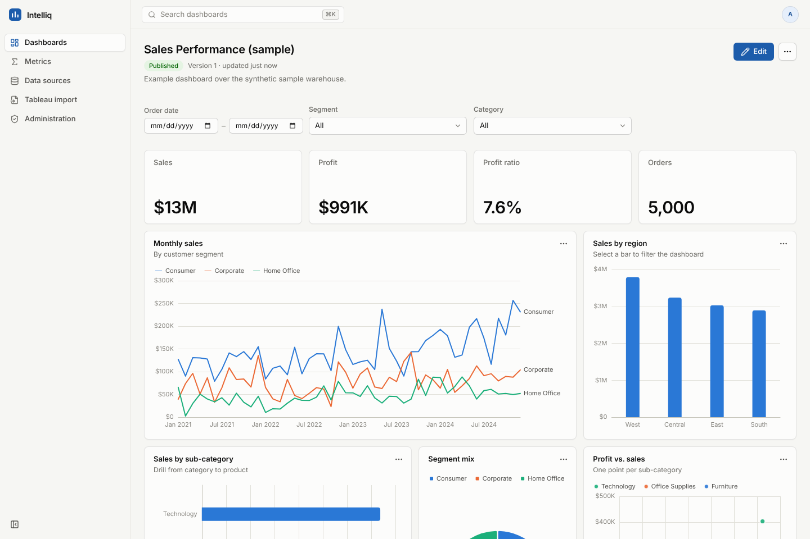

# Intelliq

Intelliq is a business-intelligence platform built to run an organisation's dashboards
without Tableau. It has its own connectors, semantic layer, query and calculation engine,
dashboard specification, renderer and editor, plus an importer that converts Tableau
workbooks and reports exactly what did and did not carry over.

**Status:** first working version. See [`docs/00-status.md`](docs/00-status.md) for test
results and [`docs/11-decisions-and-gaps.md`](docs/11-decisions-and-gaps.md) for known
gaps. Parity with Tableau has **not** yet been demonstrated on real workbooks.



## Quick start

Requirements: Python 3.11+, Node 20+.

```bash
# API (serves on :8000, creates an admin user and synthetic sample content)
cd apps/api
python -m venv .venv && .venv/bin/pip install -e ".[dev]"
INTELLIQ_DEV_ADMIN_PASSWORD=choose-a-password .venv/bin/intelliq dev

# Web (http://localhost:5173, proxies /api to :8000)
cd apps/web && npm install && npm run dev
```

Sign in as `admin@intelliq.local`. The sample warehouse is synthetic and labelled as such.

Production-style single origin: build the web app (`npm run build` in `apps/web`) and start
the API with `INTELLIQ_WEB_DIST=apps/web/dist`. Deployment and configuration are in
[`docs/10-operations.md`](docs/10-operations.md).

## Repository layout

```
apps/api/      Python package `intelliq` (FastAPI): calc, semantic, query, connectors,
               spec, importer, platform, validation, api
apps/web/      React + TypeScript (Vite): design system, viz engine, dashboard runtime,
               builder, pages
tests/e2e/     Playwright browser tests
docs/          architecture, specification, compatibility, security, operations
```

## Tests

```bash
cd apps/api && .venv/bin/python -m pytest && .venv/bin/ruff check intelliq tests
cd apps/web && npm run typecheck && npm test
npm run web:build && npm run e2e          # from the repository root
```

Connector contract tests run against a live engine when `INTELLIQ_TEST_<KIND>` is set
(see `docs/10-operations.md`).

## Documentation

| | |
|---|---|
| [00 Status](docs/00-status.md) | Phase reports, test results, what is needed next |
| [01 Audit](docs/01-audit.md) | What was accessible and what was found |
| [02 Architecture](docs/02-architecture.md) | Modules, contracts, request flow |
| [03 Dashboard spec](docs/03-dashboard-spec.md) | IDS v1, runtime state, migrations |
| [04 Semantic layer and query engine](docs/04-semantic-and-query.md) | Datasets, planner, executor, connectors |
| [05 Calculations](docs/05-calculation-compatibility.md) | Formula language, semantics, [support matrix](docs/generated/calculation-support-matrix.md) |
| [06 Tableau migration](docs/06-tableau-migration.md) | Import workflow and compatibility report |
| [07 Validation](docs/07-validation.md) | How parity is measured |
| [08 Security](docs/08-security.md) | Auth, RBAC, RLS, secrets, untrusted input |
| [09 Design system](docs/09-design-system.md) | Tokens, palette, components, accessibility |
| [10 Operations](docs/10-operations.md) | Setup, configuration, performance measurements |
| [11 Decisions and gaps](docs/11-decisions-and-gaps.md) | Decision log, prioritised gaps |
| [12 Acceptance criteria](docs/12-acceptance-criteria.md) | Status against each criterion |
